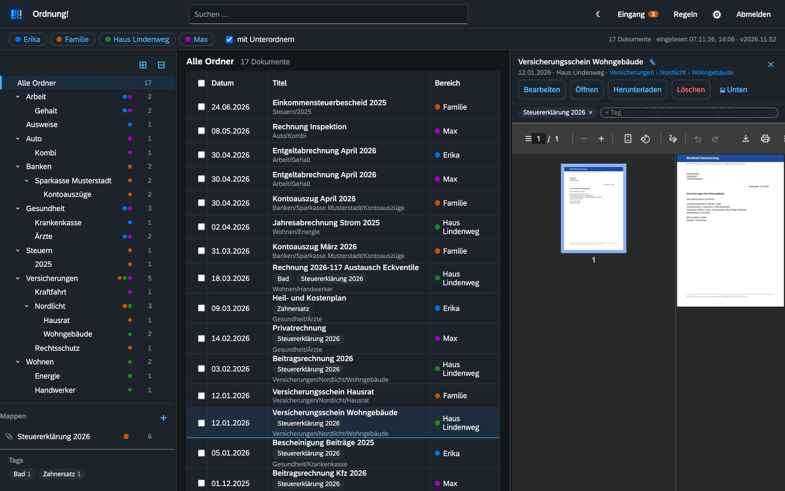
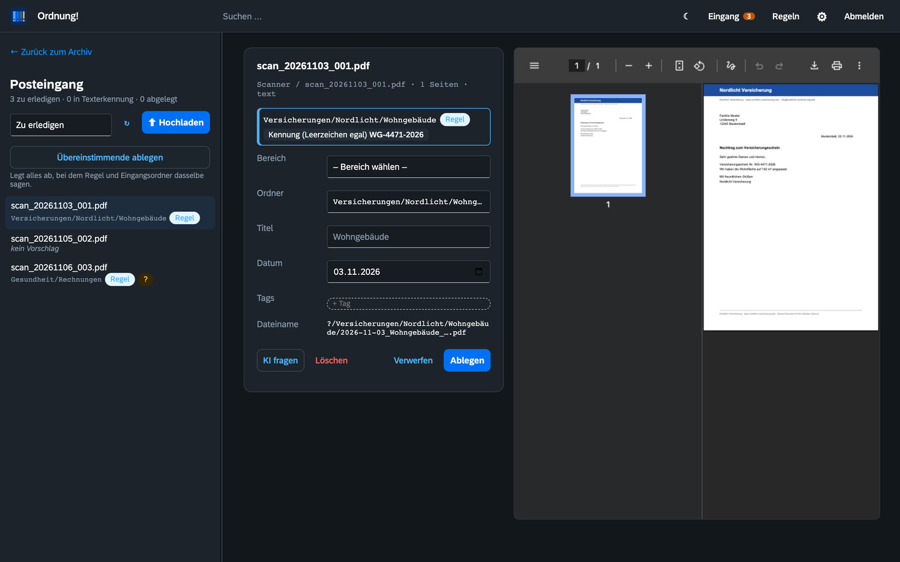
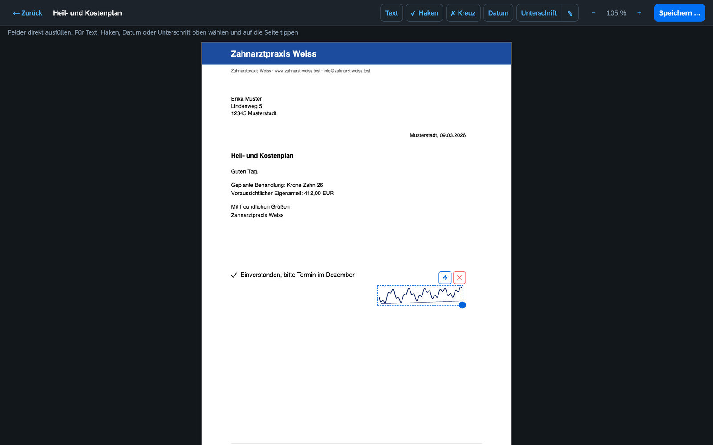
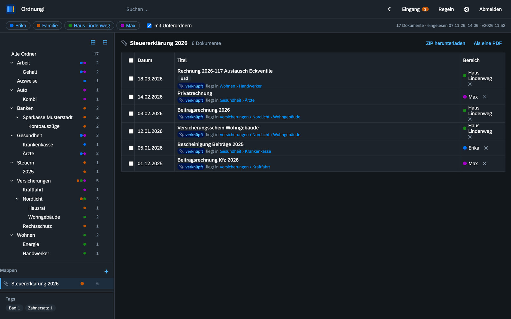
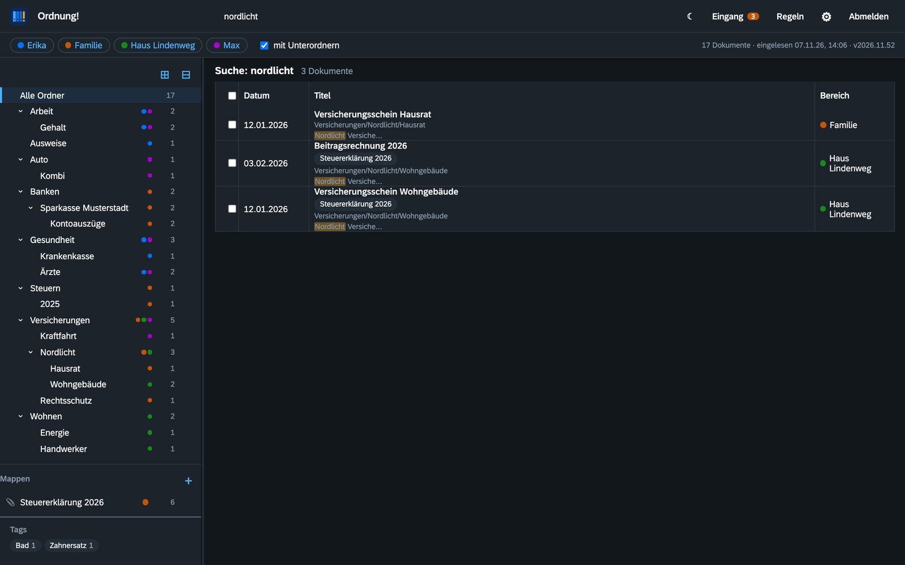

<p align="center"></p>

<h1 align="center">Ordnung!</h1>

<p align="center"><b>Ein Dokumentenarchiv für Familien und kleine Haushalte: Ordner, die man versteht, und eine Suche, die wirklich findet.</b><br>
Selbst gehostet · Open Source (AGPL-3.0) · Deutsch, Englisch, Französisch, Italienisch</p>

<p align="center"><i>English: <a href="README.md">README.md</a></i></p>



## Warum noch ein Dokumentenarchiv?

Die meisten Dokumentenverwaltungen bauen auf Tags und Filter. Das ist mächtig, aber die meisten Menschen werden damit nicht warm. **Ordnung!** dreht es um: **Ordner sind die Wahrheit.** Ein Dokument liegt dort, wo man es suchen würde (`Versicherungen › Nordlicht › Wohngebäude`), als ganz normale PDF auf der Platte. Ordnung! liest diese Ordner, macht alles durchsuchbar und hilft beim Einsortieren neuer Post. Ist die App aus, bleibt das Archiv trotzdem lesbar, im Finder, im Explorer oder per SMB, auch in zwanzig Jahren.

## Was es kann

- **Ein Baum für die ganze Familie.** Jede Person, der Haushalt oder ein Haus ist ein *Bereich*, also ein Hauptordner. Jeder sieht alle Bereiche, die er lesen darf, in einem gemeinsamen Baum. Rechte gibt es je Bereich: *lesen* oder *lesen + schreiben*. Ein Bereich muss niemandem gehören, „Haus Lindenweg“ hat einfach Mitglieder.
- **Volltextsuche** über Titel, Ordner und den Text jeder Seite, auch bei Scans (Tesseract-OCR, Deutsch und Englisch). Halbe Wörter und kleine Tippfehler finden trotzdem. `#tag` filtert nach Tags.
- **Posteingang mit Vorschlägen.** Scanner-Ordner werden beobachtet. Neue Dokumente warten im Posteingang mit Vorschlag für Ordner, Titel und Datum. Die Vorschläge kommen aus Regeln, aus dem Unterordner im Eingang oder auf Wunsch von einer KI (Claude, Ollama oder ein OpenAI-kompatibler Server). Abgelegt wird nichts ohne dich.
- **Regeln für Menschen.** Ordnung! erkennt Absender an der Web- oder Mail-Adresse im Brief und fragt nach dem Ablegen: *„Post von Nordlicht Versicherung künftig nach Versicherungen › Nordlicht › Wohngebäude?“* Eine Ampel zeigt, wie zuverlässig eine Regel auf dem vorhandenen Archiv ist.
- **Hochladen vom Handy.** Mit der iPhone-Kamera fotografieren, mehrere Seiten werden eine PDF, HEIC wird automatisch umgewandelt. Läuft als Web-App auf dem Home-Bildschirm.
- **PDF-Editor.** Formulare ausfüllen, Text, Haken, Datum und die gespeicherte Unterschrift einsetzen. Das Ergebnis wird als neues Dokument neben dem Original gespeichert, das Original bleibt unverändert.
- **Mappen.** Dokumente aus vielen Ordnern sammeln, etwa *Steuererklärung 2026*, ohne sie zu verschieben. Eine Mappe lässt sich als ZIP oder als eine zusammengefügte PDF für den Steuerberater herunterladen.
- **Tags, Papierkorb, Ziehen und Ablegen.** Dokumente auf Ordner ziehen verschiebt sie, auf Mappen ziehen verknüpft sie. Gelöschtes bleibt 30 Tage im Papierkorb (einstellbar).
- **REST-API** für alles, was die Oberfläche kann, dokumentiert unter `/docs`.
- **Umzug aus Paperless-ngx** mit einem Import-Planer.

<table>
<tr><td></td><td></td></tr>
<tr><td></td><td></td></tr>
</table>

## Schnellstart mit Docker

```yaml
services:
  ordnung:
    image: ghcr.io/orohde/ordnung:latest
    container_name: ordnung
    restart: unless-stopped
    ports:
      - "8440:8000"
    volumes:
      - ./archiv:/archiv        # die Dokumentordner – hier legt Ordnung! neue Dokumente ab
      - ./data:/data            # Index, Einstellungen, Konten
      - ./eingang:/eingang      # optional: Scanner- bzw. Eingangsordner
    environment:
      - ORDNUNG_ADMIN_USER=admin
      - ORDNUNG_ADMIN_PASSWORD=bitte-aendern
```

```bash
docker compose up -d
```

Dann `http://localhost:8440` öffnen, anmelden und unter **Einstellungen → Ablage** Archiv- und Eingangsordner einrichten. Das erste Konto kommt einmalig aus den Umgebungsvariablen, danach werden Konten in der App verwaltet.

Das Image gibt es für `linux/amd64` und `linux/arm64` (Raspberry Pi, Apple Silicon).

Unter **Unraid** installierst du es über den Reiter *Apps* (Vorlagen-Repo [orohde/unraid-templates](https://github.com/orohde/unraid-templates)).

### Einstellungen

| Variable | Standard | Bedeutung |
|---|---|---|
| `ORDNUNG_ADMIN_USER` / `ORDNUNG_ADMIN_PASSWORD` | `admin` / – | erster Administrator (nur solange noch kein Konto existiert) |
| `ORDNUNG_API_TOKEN` | – | optionales Token für Skripte: `Authorization: Bearer …` |
| `ORDNUNG_OCR` | `1` | Texterkennung für Scans |
| `ORDNUNG_OCR_LANG` | `deu+eng` | Sprachen für Tesseract |
| `ORDNUNG_RESCAN_MINUTES` | `10` | vollständiges Neueinlesen der Archivordner |
| `ORDNUNG_STARTER` | `1` | beim ersten Start Ordnervorlage „Haushalt“ und Startregeln anlegen |
| `PUID` / `PGID` / `UMASK` | `99` / `100` / `0002` | Benutzer, Gruppe und umask, als die die App läuft, wenn der Container als root startet; frisch angelegte leere Ordner bekommt dieser Benutzer (bei `--user` ohne Wirkung) |

## Demo ausprobieren

`tools/demo/make_demo.py` baut eine Installation mit einer erfundenen Familie, erfundenen Firmen und Briefen. Die Screenshots oben stammen daraus:

```bash
python tools/demo/make_demo.py /tmp/ordnung-demo --lang de
ORDNUNG_ARCHIVE=/tmp/ordnung-demo/archiv ORDNUNG_DATA=/tmp/ordnung-demo/data \
ORDNUNG_ADMIN_USER=demo ORDNUNG_ADMIN_PASSWORD=demo1234 python -m ordnung
python tools/demo/make_demo.py /tmp/ordnung-demo --lang de --setup http://localhost:8000
```

## Wie gespeichert wird

```
archiv/
  max/Gesundheit/Ärzte/2026-02-14_Privatrechnung_8f2c1a.pdf
  familie/Banken/Sparkasse Musterstadt/Kontoauszüge/2026-03-31_Kontoauszug März 2026_3ebe93.pdf
  haus/Versicherungen/Nordlicht/Wohngebäude/2026-01-12_Versicherungsschein Wohngebäude_a41b07.pdf
```

Dateinamen folgen dem Muster `Datum_Titel_ID`. Die ID ist der Anfang der SHA-256-Prüfsumme, so fallen Dubletten auf. SQLite ist nur ein Index und lässt sich jederzeit aus den Ordnern neu aufbauen. Tags, Mappen, Regeln und Konten liegen als kleine JSON-Dateien im Datenordner.

## Entwicklung

```bash
python -m venv .venv && .venv/bin/pip install -e '.[dev]'
.venv/bin/python -m pytest -q
ORDNUNG_ARCHIVE=./archiv ORDNUNG_DATA=./data ORDNUNG_ADMIN_PASSWORD=test1234 .venv/bin/python -m ordnung
```

Python · FastAPI · SQLite FTS5 · pypdfium2 · Tesseract · PDF.js · pdf-lib · SAP Fundamental Styles. Die Oberfläche braucht keinen Build-Schritt.

## Lizenz

[GNU Affero General Public License v3.0](LICENSE). Freie Software, keine Kaufversion. Mehr unter [worldgate.de](https://worldgate.de).
