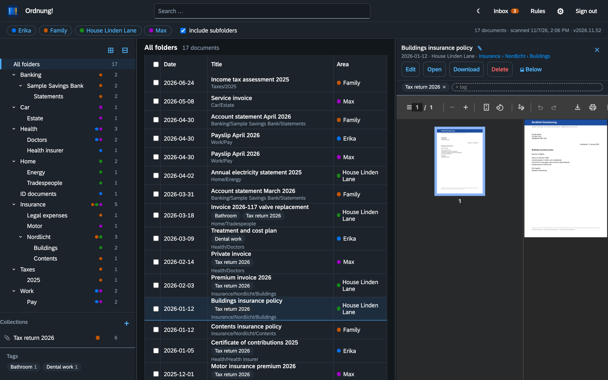
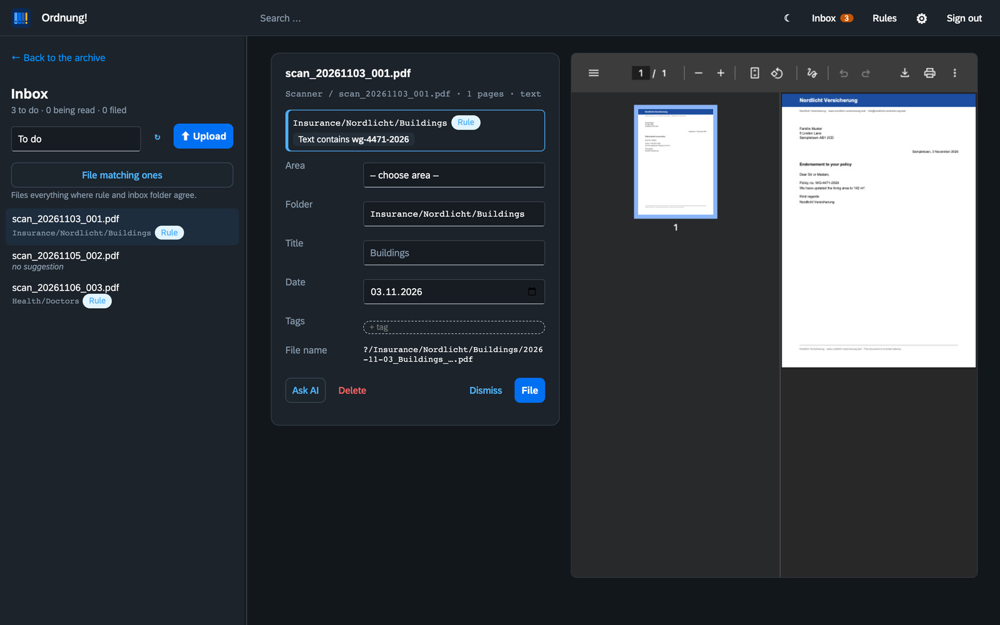
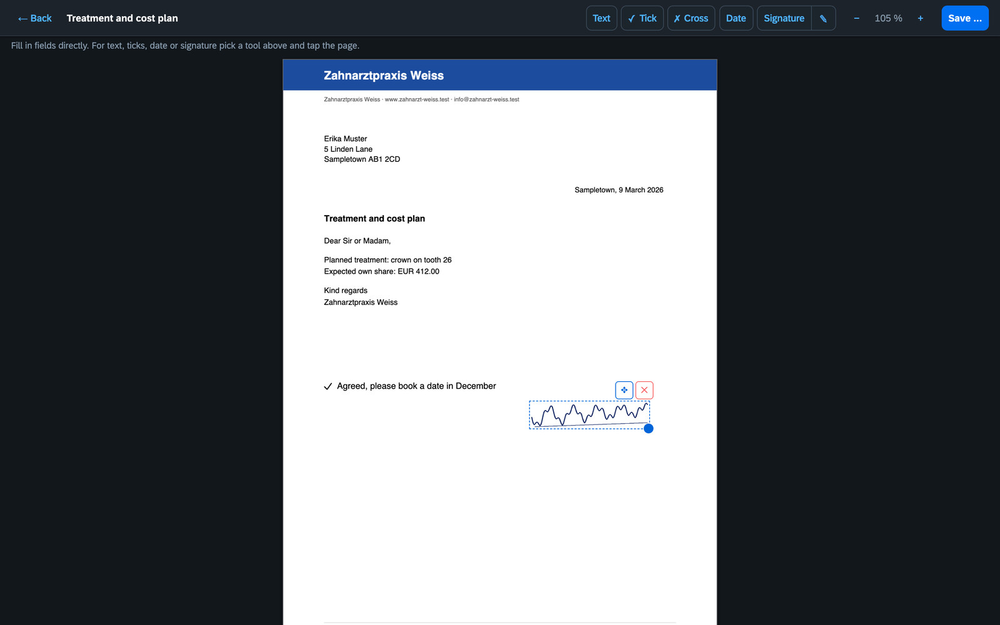
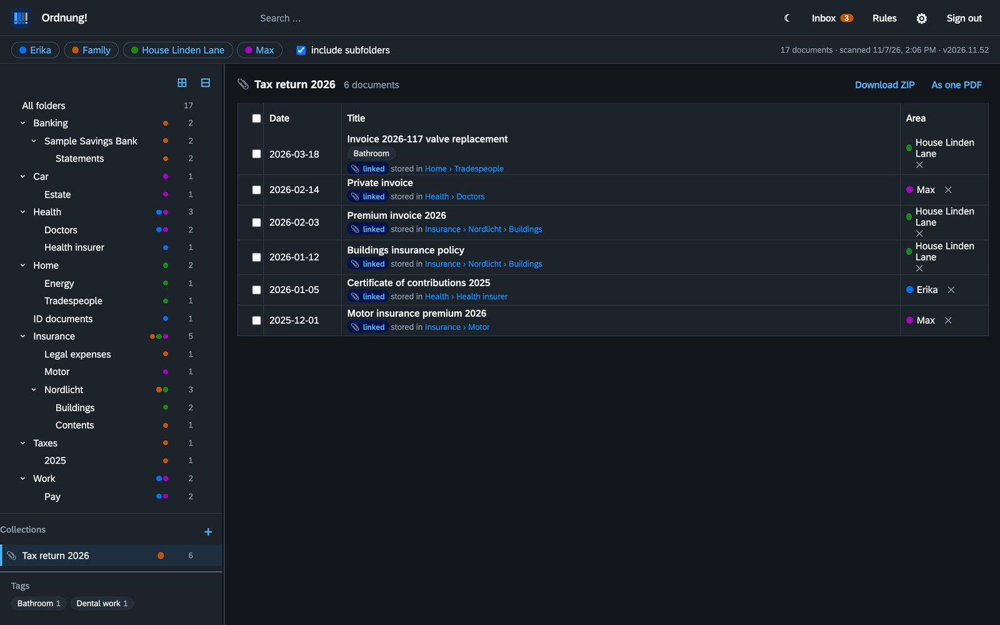
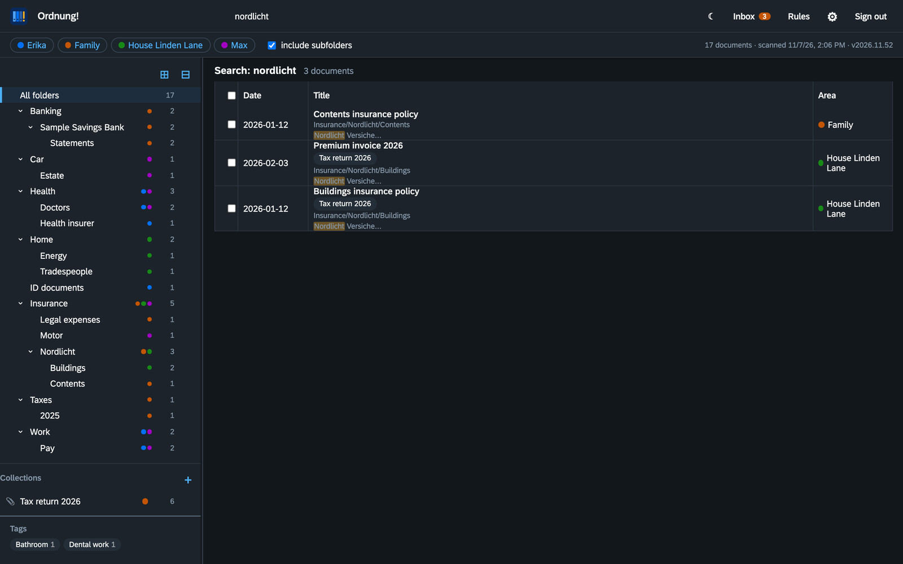

<p align="center"></p>

<h1 align="center">Ordnung!</h1>

<p align="center"><b>A document archive for families and small households – folders you already understand, a search that actually finds things.</b><br>
Self-hosted · open source (AGPL-3.0) · German, English, French, Italian</p>

<p align="center"><i>Deutsch: <a href="README.de.md">README.de.md</a></i></p>



## Why another document archive?

Most document managers are built around tags and filters. That is powerful – and most people never warm to it. **Ordnung!** turns it around: **the folders are the truth.** A document lives where you would look for it (`Insurance › Nordlicht › Buildings`), as a normal PDF on your disk. Ordnung! reads those folders, makes everything searchable and helps you file new post. Switch the app off and your archive is still perfectly readable via Finder, Explorer or SMB – in twenty years too.

## Features

- **One tree for the whole family.** Each person, the household or a house is an *area* (a top folder). Everyone sees all areas they may read in a single merged tree; rights are *read* or *read + write* per area. Areas do not need to belong to anyone – “House Linden Lane” simply has members.
- **Full-text search** over title, folder and the text of every page, scans included (Tesseract OCR, German and English). Partial words and small typos still match. `#tag` filters by tag.
- **Inbox with suggestions.** Scanner folders are watched; new documents wait in the inbox with a suggested folder, title and date. Suggestions come from rules, from the inbox subfolder, or – if you like – from an AI (Claude, Ollama or any OpenAI-compatible server). Nothing is filed without you.
- **Rules for humans.** Ordnung! recognises senders by the web or mail address in the letter and asks after filing: *“Post from Nordlicht Insurance → Insurance › Nordlicht › Buildings from now on?”* – with a traffic light that shows how reliable a rule is on your existing archive.
- **Mail inbox.** Send or forward PDFs to an address of their own, from the phone too. Ordnung! collects them via IMAP, takes PDF attachments only and only from addresses stored with a user, and presets that person's area.
- **Upload from the phone.** Take photos with the iPhone camera; several pages become one PDF, HEIC is converted automatically. Works as a home-screen web app.
- **PDF editor.** Fill in forms, add text, ticks, the date and your stored signature. The result is saved as a new document next to the original, which stays untouched.
- **Collections.** Gather documents from many folders – *Tax return 2026* – without moving them. Download a collection as ZIP or as one merged PDF for your tax advisor.
- **Tags, trash, drag and drop.** Drag documents onto folders to move them, onto collections to link them. Deleted documents stay in the trash for 30 days (configurable).
- **Old files.** Papers you no longer need but want to keep: one by one, a whole folder or “everything older than X years” go to `<area>/Altablage/`. The tree keeps them apart, the search finds them only on request, taking them back restores the old folder.
- **REST API** for everything the UI does, documented at `/docs`.
- **Moving from Paperless-ngx** is supported with an import planner.

<table>
<tr><td></td><td></td></tr>
<tr><td></td><td></td></tr>
</table>

## Quick start with Docker

```yaml
services:
  ordnung:
    image: ghcr.io/orohde/ordnung:latest
    container_name: ordnung
    restart: unless-stopped
    ports:
      - "8440:8000"
    volumes:
      - ./archiv:/archiv        # your document folders – Ordnung! files new documents here
      - ./data:/data            # index, settings, accounts
      - ./eingang:/eingang      # optional: scanner / inbox folders
    environment:
      - ORDNUNG_ADMIN_USER=admin
      - ORDNUNG_ADMIN_PASSWORD=change-me
```

```bash
docker compose up -d
```

Open `http://localhost:8440`, sign in, and set up your archive and inbox folders under **Settings → Storage**. The first account comes from the environment once; afterwards accounts are managed in the app.

The image is built for `linux/amd64` and `linux/arm64` (Raspberry Pi, Apple silicon).

On **Unraid**, install it from the *Apps* tab (template repository [orohde/unraid-templates](https://github.com/orohde/unraid-templates)).

### Settings

| Variable | Default | Meaning |
|---|---|---|
| `ORDNUNG_ADMIN_USER` / `ORDNUNG_ADMIN_PASSWORD` | `admin` / – | first administrator (only used while no account exists) |
| `ORDNUNG_API_TOKEN` | – | optional token for scripts: `Authorization: Bearer …` |
| `ORDNUNG_OCR` | `1` | text recognition for scans |
| `ORDNUNG_OCR_LANG` | `deu+eng` | Tesseract languages |
| `ORDNUNG_RESCAN_MINUTES` | `10` | full rescan of the archive folders |
| `ORDNUNG_STARTER` | `1` | ship a household folder template and starter rules on first start |
| `ORDNUNG_INTERNAL_NETWORKS` | private ranges | comma-separated CIDR ranges that count as the home network (LAN, VPN); everything else is "outside" |
| `PUID` / `PGID` / `UMASK` | `99` / `100` / `0002` | user, group and umask the app runs as when the container starts as root; fresh empty folders are handed over to that user (ignored with `--user`) |

### Signing in from outside

Behind a reverse proxy that **overwrites** `X-Forwarded-For` (Caddy does by default), Ordnung! knows whether a sign-in comes from the home network or from outside. Under *Settings → Security* you can allow access from outside only for accounts with a second factor (authenticator app, with ten one-time recovery codes), and have every sign-in from outside, locked accounts and changes to the second factor reported via [ntfy](https://ntfy.sh). Sessions are kept on the server: signing out, changing the password or *Sign out all others* under *My account* really ends them. After five failed attempts an account is paused for a minute, doubling up to 15 minutes, counted separately for inside and outside.

### Mail inbox

Create a mailbox of its own (say `inbox@example.org`) and enter IMAP server, user and password under *Settings → Mail inbox*. With each user, list the addresses they send from under *E-mail addresses* (several separated by commas). Ordnung! collects every minute and puts the PDF attachments into the inbox, forwarded mails included. The area is the sender's, adjustable under *Mails belong to*. Mails from unknown addresses, without a PDF or with a forged sender (according to the mail server's `Authentication-Results`) are moved to `Abgelehnt` in the mailbox and deleted after 7 days (configurable, 0 = at once). Taken mails end up in `Abgelegt`.

## Try the demo

`tools/demo/make_demo.py` builds an installation with an invented family, invented companies and letters (the screenshots above come from it):

```bash
python tools/demo/make_demo.py /tmp/ordnung-demo --lang en
ORDNUNG_ARCHIVE=/tmp/ordnung-demo/archiv ORDNUNG_DATA=/tmp/ordnung-demo/data \
ORDNUNG_ADMIN_USER=demo ORDNUNG_ADMIN_PASSWORD=demo1234 python -m ordnung
python tools/demo/make_demo.py /tmp/ordnung-demo --lang en --setup http://localhost:8000
```

## How it stores things

```
archiv/
  max/Health/Doctors/2026-02-14_Private invoice_8f2c1a.pdf
  familie/Banking/Sample Savings Bank/Statements/2026-03-31_Account statement March 2026_3ebe93.pdf
  haus/Insurance/Nordlicht/Buildings/2026-01-12_Buildings insurance policy_a41b07.pdf
```

File names follow `date_title_id`; the id is the start of the file's SHA-256, so duplicates are recognised. SQLite is only an index and can be rebuilt from the folders at any time. Tags, collections, rules and accounts live as small JSON files in the data folder.

## Development

```bash
python -m venv .venv && .venv/bin/pip install -e '.[dev]'
.venv/bin/python -m pytest -q
ORDNUNG_ARCHIVE=./archiv ORDNUNG_DATA=./data ORDNUNG_ADMIN_PASSWORD=test1234 .venv/bin/python -m ordnung
```

Python · FastAPI · SQLite FTS5 · pypdfium2 · Tesseract · PDF.js · pdf-lib · SAP Fundamental Styles. No build step for the web UI.

## License

[GNU Affero General Public License v3.0](LICENSE). Free software, no paid edition. More at [worldgate.de](https://worldgate.de).
